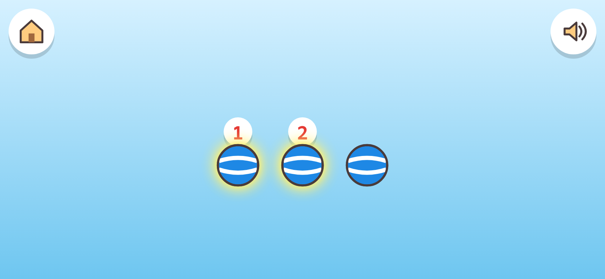
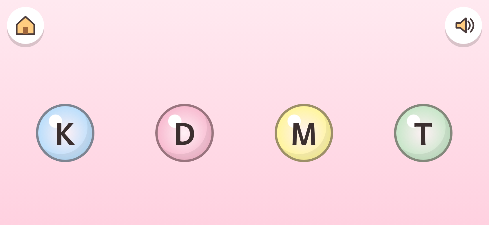

# Kebun Ceria

Permainan belajar berbasis web untuk anak usia 2–5 tahun: membaca, berhitung, serta warna dan bentuk.
Bisa dipasang ke layar utama HP seperti aplikasi dan dimainkan tanpa internet.

**Demo:** https://yuuarr.github.io/kebun-ceria/ (kode akses pengembangan: `CERIA-2026`)

> **English summary.** Kebun Ceria is an installable, offline-first PWA of educational mini-games for
> children aged 2–5, in Indonesian. Vanilla TypeScript + Vite + SVG, no UI framework, ~28 KB gzipped
> JS+CSS. Voice-first UX (children can't read yet), no fail states, and a garden that grows as the child
> plays. Unit-tested with Vitest, end-to-end tested with Playwright on phone viewports, deployed to
> GitHub Pages by GitHub Actions.


| Sentuh & Hitung | Kuas Ajaib Warna | Gelembung Huruf |
|---|---|---|
|  |  |  |

## Isi

Anak dipandu kelinci **Cici** di sebuah peta kebun dengan tiga area, masing-masing berisi 4 permainan (12 total):

**Kolam Angka**
- **Sentuh & Hitung**: ketuk benda satu per satu, narator ikut menghitung; benda yang sudah dihitung tidak terhitung dua kali.
- **Kasih Makan Monyet**: geser pisang sebanyak yang diminta monyet; kelebihan ditolak dengan lucu.
- **Banyak-Sedikit**: pilih keranjang yang lebih banyak/sedikit atau benda yang lebih besar/kecil.
- **Sungai Angka**: pasang batu angka yang hilang supaya Cici bisa melompat menyeberang sambil menghitung.

**Taman Warna**
- **Kuas Ajaib Warna**: pilih ember, ketuk gambar, langsung berwarna penuh.
- **Kotak Pos Bentuk**: masukkan donat, pizza, kado ke lubang yang bentuknya sama.
- **Sortir Keranjang Warna**: kelompokkan benda ke keranjang berwarna sama.
- **Rakit Roket**: susun bentuk dasar menjadi roket, kereta, atau rumah, lalu lihat hasilnya bergerak.

**Pondok Huruf**
- **Gelembung Huruf**: dengar bunyi huruf, ketuk gelembung yang cocok.
- **Cocokkan Huruf Awal**: geser gambar ke kotak huruf depannya ("/b/… untuk bola").
- **Kartu Kata Berbicara**: ketuk gambar untuk mendengar kata, ketuk huruf depan untuk mendengar bunyinya.
- **Cerita Bergambar**: cerita pendek yang katanya menyala mengikuti narator; benda di gambar bisa diketuk.

Semua permainan menyesuaikan tingkat kesulitan dengan pilihan usia (2–3 atau 4–5 tahun) di Pojok Orang Tua.
Setiap ronde yang selesai membuat kebun di peta bertambah satu tahap (40 tahap): bunga mekar, pohon berbuah, hewan berdatangan. Kebun tidak pernah layu.

## Prinsip desain

Disusun **berdasarkan prinsip** Montessori (benda konkret, koreksi diri tanpa hukuman, satu konsep per aktivitas),
Konkret–Gambar–Abstrak untuk berhitung, fonik menuju suku kata untuk membaca, dan belajar sambil bermain ala Kurikulum Merdeka PAUD.

Aturan yang berlaku di semua permainan:

- Instruksi 100% suara; teks hanya untuk huruf/angka yang sedang dipelajari.
- Tidak ada tanda silang, suara "salah", skor, waktu, atau kalah.
- Target sentuh minimal 64 px, satu fokus per layar.
- Warna selalu disertai bentuk (aman untuk anak buta warna).
- Tidak ada iklan, pelacakan, atau link keluar. Data hanya di perangkat.
- Pojok Orang Tua dibuka dengan menahan tombol 3 detik (pengaturan usia 2–3 / 4–5, volume, penjelasan metode).

## Struktur folder

```
kebun-ceria/
├─ src/
│  ├─ core/       logika murni & layanan: storage, access, settings, garden, rng, audio, router, tap, drag, celebrate
│  ├─ content/    naskah suara (lines.ts), urutan huruf fonik, daftar kata, cerita
│  ├─ art/        semua gambar sebagai fungsi SVG: maskot, benda, kebun, sketsa, ikon area
│  ├─ ui/         layar: mulai, kode akses, peta, area, permainan, Pojok Orang Tua
│  ├─ games/      satu folder per permainan: logic.ts (murni, diuji) + view.ts (DOM/SVG) + index.ts (pendaftaran)
│  ├─ styles/     CSS dan design token
│  ├─ config.ts   hash kode akses dan versi
│  └─ main.ts     titik masuk aplikasi
├─ public/        ikon aplikasi dan file suara (public/audio/<id>.mp3)
├─ audio/         naskah.csv: daftar kalimat narator yang perlu direkam
├─ scripts/       alat bantu: kode akses, naskah, ikon, screenshot
├─ tests/
│  ├─ unit/       Vitest (logika, suara, akses, kebun)
│  └─ e2e/        Playwright (alur nyata di viewport HP tidur & berdiri, offline)
├─ docs/          panduan pemilik dan screenshot
└─ .github/       CI: tes, build, deploy ke GitHub Pages
```

## Arsitektur

- Setiap layar adalah fungsi `(root, params) => cleanup`; router kecil menukar layar.
- Logika permainan terpisah dari tampilan sehingga bisa diuji tanpa browser.
- **Suara:** `AudioService.play(id)` memutar `public/audio/<id>.mp3`; jika file belum ada, memakai suara browser (`id-ID`); selalu selesai dalam 8 detik sehingga permainan tidak pernah macet. Efek suara disintesis dengan Web Audio.
- **Kode akses:** satu kode untuk semua pembeli, hanya hash SHA-256 yang disimpan di kode. Di balik antarmuka `AccessProvider` sehingga bisa diganti ke kode unik per pembeli tanpa mengubah permainan.
- **Geser-lepas magnetis:** `makeDraggable` di `src/core/drag.ts` dipakai 6 permainan; target dipilih dari posisi jari dengan radius tarik 90 px, benda yang salah terbang pulang dengan lembut.
- **PWA:** `vite-plugin-pwa` (Workbox) menyimpan semua file untuk dipakai offline.

## Menjalankan

```bash
npm install
npm run dev        # server pengembangan
npm test           # unit test (Vitest)
npm run e2e        # end-to-end (Playwright, viewport HP tidur & berdiri)
npm run build      # build produksi ke dist/
npm run naskah     # tulis ulang audio/naskah.csv dari src/content/lines.ts
npm run kode -- KODE-BARU   # buat hash untuk kode akses baru
npm run icons      # buat ulang ikon dari maskot (perlu npm run dev berjalan)
npm run screenshots   # buat ulang screenshot README (perlu npm run preview berjalan)
```

Butuh Node.js 20 atau lebih baru (lihat `.nvmrc`).

Kode akses untuk pengembangan: `CERIA-2026` (ganti sebelum dijual, lihat panduan).

Panduan untuk pemilik (ganti kode, rekam suara, deploy): [docs/PANDUAN-PEMILIK.md](docs/PANDUAN-PEMILIK.md).

## Lisensi

Kode sumber dapat dilihat untuk keperluan belajar dan portofolio, tetapi **hak cipta dilindungi**. Lihat [LICENSE](LICENSE). Font: [CREDITS.md](CREDITS.md).
