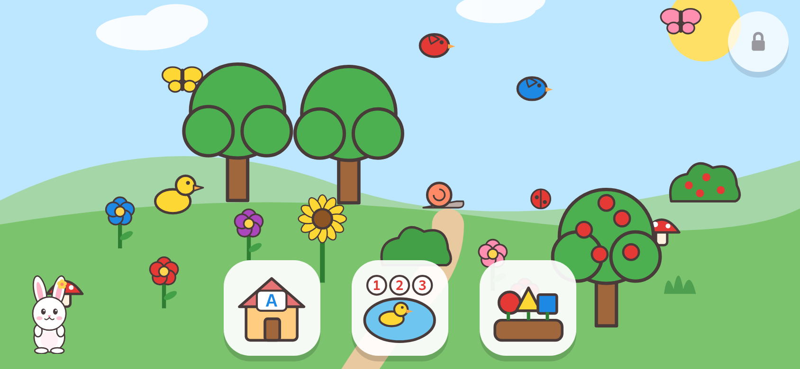
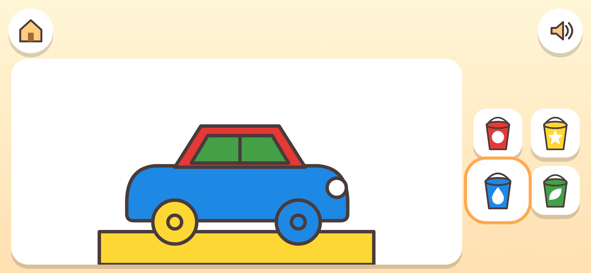

# Kebun Ceria

Permainan belajar berbasis web untuk anak usia 2–5 tahun: membaca, berhitung, serta warna dan bentuk.
Bisa dipasang ke layar utama HP seperti aplikasi dan dimainkan tanpa internet.

> **English summary.** Kebun Ceria is an installable, offline-first PWA of educational mini-games for
> children aged 2–5, in Indonesian. Vanilla TypeScript + Vite + SVG, no UI framework, ~28 KB gzipped
> JS+CSS. Voice-first UX (children can't read yet), no fail states, and a garden that grows as the child
> plays. Unit-tested with Vitest, end-to-end tested with Playwright on phone viewports, deployed to
> GitHub Pages by GitHub Actions.



| Sentuh & Hitung | Kuas Ajaib Warna | Gelembung Huruf |
|---|---|---|
|  |  |  |

## Isi

Anak dipandu kelinci **Cici** di sebuah peta kebun dengan tiga area:

- **Kolam Angka — Sentuh & Hitung.** Ketuk benda satu per satu; angka muncul dan narator ikut menghitung. Benda yang sudah dihitung bersinar dan tidak terhitung dua kali.
- **Taman Warna — Kuas Ajaib Warna.** Pilih ember warna, ketuk bagian gambar, langsung terisi penuh. Tidak ada warna yang "salah".
- **Pondok Huruf — Gelembung Huruf.** Dengar bunyi huruf, ketuk gelembung yang cocok. Gelembung yang salah hanya memantul lembut.

Setiap ronde yang selesai membuat kebun di peta bertambah satu tahap (40 tahap): bunga mekar, pohon berbuah, hewan berdatangan. Kebun tidak pernah layu.

## Prinsip desain

Disusun **berdasarkan prinsip** Montessori (benda konkret, koreksi diri tanpa hukuman, satu konsep per aktivitas),
Konkret–Gambar–Abstrak untuk berhitung, fonik menuju suku kata untuk membaca, dan belajar sambil bermain ala Kurikulum Merdeka PAUD.

Aturan yang berlaku di semua permainan:

- Instruksi 100% suara; teks hanya untuk huruf/angka yang sedang dipelajari.
- Tidak ada tanda silang, suara "salah", skor, waktu, atau kalah.
- Target sentuh minimal 64 px, satu fokus per layar.
- Warna selalu disertai bentuk (aman untuk anak buta warna).
- Tidak ada iklan, pelacakan, atau link keluar. Data hanya di perangkat.
- Pojok Orang Tua dibuka dengan menahan tombol 3 detik (pengaturan usia 2–3 / 4–5, volume, penjelasan metode).

## Arsitektur

```
src/
  core/      logika murni & layanan: storage, access, settings, garden, rng, audio, router, tap, celebrate
  content/   naskah suara (lines.ts) dan urutan huruf fonik
  art/       semua gambar sebagai fungsi SVG (maskot, benda, kebun, sketsa)
  ui/        layar: mulai, kode akses, peta, area, permainan, Pojok Orang Tua
  games/     satu folder per permainan: logic.ts (murni, diuji) + view.ts (DOM/SVG)
```

- Setiap layar adalah fungsi `(root, params) => cleanup`; router kecil menukar layar.
- Logika permainan terpisah dari tampilan sehingga bisa diuji tanpa browser.
- **Suara:** `AudioService.play(id)` memutar `public/audio/<id>.mp3`; jika file belum ada, memakai suara browser (`id-ID`); selalu selesai dalam 8 detik sehingga permainan tidak pernah macet. Efek suara disintesis dengan Web Audio.
- **Kode akses:** satu kode untuk semua pembeli, hanya hash SHA-256 yang disimpan di kode. Di balik antarmuka `AccessProvider` sehingga bisa diganti ke kode unik per pembeli tanpa mengubah permainan.
- **PWA:** `vite-plugin-pwa` (Workbox) menyimpan semua file untuk dipakai offline.

## Menjalankan

```bash
npm install
npm run dev        # server pengembangan
npm test           # unit test (Vitest)
npm run e2e        # end-to-end (Playwright, viewport HP tidur & berdiri)
npm run build      # build produksi ke dist/
npm run naskah     # tulis ulang audio/naskah.csv dari src/content/lines.ts
npm run kode -- KODE-BARU   # buat hash untuk kode akses baru
```

Kode akses untuk pengembangan: `CERIA-2026` (ganti sebelum dijual, lihat panduan).

Panduan untuk pemilik (ganti kode, rekam suara, deploy): [docs/PANDUAN-PEMILIK.md](docs/PANDUAN-PEMILIK.md).

## Lisensi

Kode sumber dapat dilihat untuk keperluan belajar dan portofolio, tetapi **hak cipta dilindungi**. Lihat [LICENSE](LICENSE). Font: [CREDITS.md](CREDITS.md).
